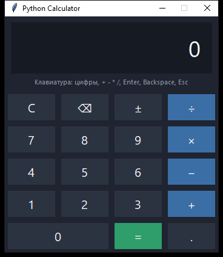

# Python Calculator

Мой первый настольный калькулятор на Python с графическим интерфейсом на Tkinter.
Проект учебный: он показывает, как собрать небольшое приложение, покрыть его
автоматическими тестами и опубликовать на GitHub.



## Возможности

- Сложение, вычитание, умножение и деление (`+`, `-`, `*`, `/`).
- Ввод дробных чисел (кнопка `.`).
- Очистка всего выражения (кнопка `C`) и удаление последнего символа (`⌫`).
- Смена знака числа (кнопка `±`).
- Цепочка операций выполняется слева направо, как в обычном карманном
  калькуляторе: `2 + 3 * 4 = 20`.
- Деление на ноль не роняет программу — на экране появляется `Error`,
  а следующий ввод начинает новое вычисление.
- Управление с клавиатуры: цифры, `+ - * /`, `Enter` или `=` (результат),
  `Backspace` (удалить символ), `Esc` (очистить).

## Технологии

- **Python 3.10+** — язык программирования.
- **Tkinter** — стандартная библиотека Python для графического интерфейса
  (ничего дополнительно устанавливать не нужно).
- **unittest** — стандартная библиотека для автоматических тестов.

Сторонних зависимостей у проекта нет, поэтому `requirements.txt` не нужен.

## Запуск

### Windows

Дважды кликните по `run.bat` в папке проекта — скрипт сам найдёт Python
и запустит калькулятор.

### Через Python (любая ОС)

```bash
python calculator.py
```

Если в системе команда `python` не найдена, попробуйте `py calculator.py`
(Windows) или `python3 calculator.py` (Linux/macOS).

## Автоматические тесты

Из корня проекта выполните:

```bash
python -m unittest -v
```

Будут проверены арифметика, ввод чисел, удаление символов, смена знака,
цепочки операций и обработка деления на ноль.

## Структура проекта

```text
python-calculator/
├── calculator.py          # логика калькулятора и окно Tkinter
├── run.bat                # запуск в один клик (Windows)
├── tests/
│   ├── __init__.py
│   └── test_calculator.py # автоматические тесты
├── docs/
│   └── screenshot.png     # скриншот интерфейса
├── README.md
└── .gitignore
```

Логика (`CalculatorEngine`) отделена от интерфейса (`CalculatorApp`),
поэтому её можно тестировать без запуска окна.

## Ограничения

- Нет истории вычислений и памяти (кнопок `M+`, `MR` и т. п.).
- Нет научных функций: корней, степеней, тригонометрии.
- Нет процентов и скобок.
- Результат показывается с точностью до 10 значащих цифр.
- Интерфейс только на русском языке (подсказка по клавиатуре) и не
  масштабируется под маленькие экраны.

## О проекте

Проект сделан в рамках учебной задачи по публикации первого репозитория.
При разработке использовались **OpenCode** (AI-агент для написания кода
и работы с Git) и модель **DeepSeek**.

## Релиз

Готовая сборка для Windows (`Calculator.exe`) приложена к разделу
[Releases](../../releases) и не хранится в основном репозитории.
